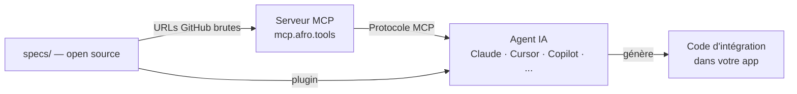

# Afro.tools — les API africaines, prêtes pour l'IA

🇫🇷 Français · 🇬🇧 [English](./README.md)

[](https://mcptry.com/servers/io.github.afrotools/afrotools)

> Intégrez Wave, Paycard ou n'importe quelle API africaine en un seul prompt.

Les API africaines ont une qualité de production. Ce qui manquait, c'est un format
standard et lisible par une machine, que les agents IA peuvent consommer
directement — sans lire des pages de documentation ni deviner la structure des requêtes.

Afro.tools comble ce manque : un registre open source et statique de specs
structurées pour les API africaines, écrites à partir de la documentation
officielle de chaque fournisseur. Chaque fournisseur est **AI Ready** : un
agent reçoit une description structurée de ce qu'il lui faut exactement pour
générer le code d'intégration. Une spec peut encore contenir des erreurs — son
`status` dit jusqu'où elle a été vérifiée (`verified` = testée par rapport à l'API du
fournisseur par un mainteneur).

---

## Comment ça marche



---

## Qu'est-ce qu'une spec ?

Une spec se trouve à `specs/{category}/{provider}/{capability}/` et contient exactement deux fichiers :

- **`schema.json`** — description conforme ATSS de la capacité de l'API (endpoint, auth, schémas d'entrée/sortie, pièges)
- **`canonical_example.ts`** — implémentation TypeScript en fetch natif, qui compile avec `tsc --noEmit`

Chaque fournisseur a aussi un **`provider.json`** à la racine de son dossier :

```
specs/payment/paycard/
├── provider.json                    ← métadonnées + description + example_prompt
├── create_payment/
│   ├── schema.json
│   └── canonical_example.ts
├── verify_payment/
└── webhook_payment_completed/
```

Voir [ATSS.md](./ATSS.md) pour la spécification complète (en anglais).

---

## Fournisseurs

Le tableau des fournisseurs (nom, catégorie, pays, capacités, statut) est régénéré
automatiquement à chaque merge sur `main` — pour éviter qu'une copie traduite ne
dérive de la réalité comme c'est déjà arrivé deux fois dans ce repo (voir
`ATSS.md` § Provider index), il n'est pas dupliqué ici. Consultez-le dans le
[README anglais](./README.md#providers), ou parcourez une page par fournisseur
— capacités, pièges, qui peut ouvrir un compte — sur
[afro.tools/fr/providers](https://afro.tools/fr/providers).

---

## Utiliser avec un client MCP

Le serveur répond à `https://mcp.afro.tools/mcp` (Streamable HTTP, sans clé). Dans Claude Code, préférez le [plugin](#plugin-claude-code) : il ajoute aussi les skills.

### Claude (claude.ai et Claude Desktop)

afro.tools est dans l'annuaire des connecteurs Claude : [claude.ai/directory/afrotools](https://claude.ai/directory/afrotools). Dans Claude, allez dans Personnaliser → Connecteurs → Découvrir, recherchez afro.tools, puis Connecter à Claude. Sur les plans Team et Enterprise, un propriétaire l'ajoute d'abord pour l'organisation.

### Claude Code (serveur MCP seul)

```bash
claude mcp add --transport http afrotools https://mcp.afro.tools/mcp
```

### ChatGPT

Sur le web : Plugins → + → Add custom MCP server, collez `https://mcp.afro.tools/mcp` avec authentication None, puis Create as a plugin et installez-le. OpenAI le propose sur les plans Business, Enterprise et Edu ; sur Business, seuls les admins et propriétaires peuvent l'ajouter.

### Codex

```bash
codex mcp add afrotools --url https://mcp.afro.tools/mcp
```

### Cursor

Dans `.cursor/mcp.json` (un projet) ou `~/.cursor/mcp.json` (tous les projets) :

```json
{
  "mcpServers": {
    "afrotools": {
      "url": "https://mcp.afro.tools/mcp"
    }
  }
}
```

### VS Code (mode agent Copilot)

Dans `.vscode/mcp.json` (la clé de premier niveau est `servers`) :

```json
{
  "servers": {
    "afrotools": {
      "type": "http",
      "url": "https://mcp.afro.tools/mcp"
    }
  }
}
```

### Windsurf et Antigravity

Windsurf : `mcp_config.json`, ouvert depuis Cascade (… → Open MCP config file). Antigravity : `~/.gemini/config/mcp_config.json`. Les deux utilisent la clé `serverUrl` :

```json
{
  "mcpServers": {
    "afrotools": {
      "serverUrl": "https://mcp.afro.tools/mcp"
    }
  }
}
```

### Gemini CLI

```bash
gemini mcp add --transport http -s user afrotools https://mcp.afro.tools/mcp
```

---

## Plugin Claude Code

```
/plugin install afrotools --marketplace afrotools/afrotools
```

Sur une version de Claude Code antérieure à 2.1.275, en deux étapes :

```
/plugin marketplace add afrotools/afrotools
/plugin install afrotools
```

**Skills auto-activés** selon le contexte :
- `studio` — **afro.tools Studio**, quand vous décrivez une app ou un service à créer pour un marché africain : de l'idée à une app en production (un plan court, un design propre, le mobile money, les SMS et WhatsApp branchés depuis le registre, des vérifications avant la mise en ligne). Il demande confirmation avant de démarrer, et vous pouvez aussi taper `/afrotools:studio`. Fonctionne aussi pour les non-développeurs : il explique en mots simples et ne demande que ce qui est nécessaire. Voir [STUDIO.md](./STUDIO.md) (en anglais) pour sa structure
- `payment` — intégrer une API de paiement
- `communications` — intégrer une API SMS, WhatsApp, USSD, voix ou email
- `identity` — intégrer une API de vérification d'identité (KYC, document, AML)
- `logistics` — intégrer une API de livraison ou de coursier (tarif, réservation, suivi, annulation de livraisons)
- `language` — intégrer une API de synthèse ou reconnaissance vocale pour les langues africaines
- `debug` — quand une intégration basée sur une spec afrotools échoue → diagnostique si le problème vient d'une erreur de spec, d'un piège manquant ou d'un changement d'API non documenté

**Commandes manuelles :**
- `/afrotools:spec <provider> <capability>` — inspecter une spec complète
- `/afrotools:list` — lister toutes les specs disponibles
- `/afrotools:new <category> <provider> <capability>` — générer le squelette d'une nouvelle spec
- `/afrotools:check` — avant la mise en ligne : clés dans le code ou le navigateur, paiements confirmés côté serveur, rien payé deux fois, webhooks vérifiés
- `/afrotools:review [audit]` — une revue de code ou un audit de sécurité par un relecteur séparé
- `/afrotools:diagnose` — quelque chose s'est mal passé avec Studio ou un skill : un rapport de bug nettoyé que vous soumettez vous-même

Studio propose trois compagnons optionnels une seule fois, jamais obligatoires : [superpowers](https://github.com/obra/superpowers) (méthode de planification), [Impeccable](https://github.com/pbakaus/impeccable) (conçoit les écrans et les critique avant tout code) et [Playwright MCP](https://github.com/microsoft/playwright-mcp) (vérifie les écrans dans un navigateur).

---

## Contribuer

Voir [CONTRIBUTING.fr.md](./CONTRIBUTING.fr.md) pour ajouter une spec ou en améliorer une
existante. Pas le temps de l'écrire vous-même ? Partagez la documentation du
fournisseur — un lien ou un fichier — sur
[afro.tools/fr/contribute](https://afro.tools/fr/contribute), et on écrit la spec pour vous.

**Vous avez intégré un fournisseur ?** [Signalez-le](https://github.com/afrotools/afrotools/issues/new?template=integration-report.yml) — que ça ait marché ou pas, en sandbox ou en
production. Un rapport positif peut faire passer la spec en `verified`, à votre crédit ; un
rapport négatif fait corriger la spec.

Cycle de vie d'une spec : `draft → ready → verified`

Chaque fournisseur du registre est **AI Ready** : ses specs donnent à un agent une description structurée et lisible par une machine pour l'intégrer. AI Ready n'est pas une garantie que la spec est sans erreur — `verified` marque les specs testées par rapport à l'API du fournisseur — par un mainteneur ou via un rapport d'intégration accepté — et dit où : en sandbox ou en production.

---

## Licence

Apache 2.0 — voir [LICENSE](./LICENSE).
