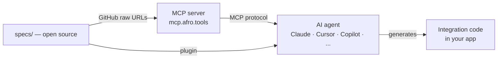

# Afro.tools — AI-ready infrastructure for African APIs

> Integrate Wave, Paycard, and any African API in a single prompt.

African APIs are production-grade. What's been missing is a standard,
machine-readable format that AI agents can consume directly — without
parsing documentation pages or guessing at request shapes.

Afro.tools fills that gap: a static, open-source registry of structured
specs for African APIs, written from each provider's official documentation.
Every provider is **AI Ready**: an agent gets a structured description of
exactly what it needs to generate integration code. A spec can still contain
errors — its `status` says how far it has been checked (`verified` = tested
against the provider's API by a maintainer).

---

## How it works



---

## What is a spec?

A spec lives at `specs/{category}/{provider}/{capability}/` and contains exactly two files:

- **`schema.json`** — ATSS-compliant description of the API capability (endpoint, auth, input/output schemas, gotchas)
- **`canonical_example.ts`** — TypeScript implementation using native fetch, compiles with `tsc --noEmit`

Each provider also has a **`provider.json`** at the root of its folder:

```
specs/payment/paycard/
├── provider.json                    ← metadata + description + example_prompt
├── create_payment/
│   ├── schema.json
│   └── canonical_example.ts
├── verify_payment/
└── webhook_payment_completed/
```

See [ATSS.md](./ATSS.md) for the full specification.

---

## Providers

<!-- tableau généré automatiquement par le pipeline — ne pas éditer manuellement -->
| Provider | Category | Country | Capabilities | Status |
|----------|----------|---------|--------------|--------|
| Paycard | payment | 🇬🇳 | 3 | ✅ All verified |
| SasPay | payment | 🇧🇫 🇧🇯 🇨🇩 +15 | 13 | 7 verified · 6 ready |
| Smile ID | identity | 🇨🇮 🇸🇳 🇬🇳 +3 | 11 | 7 verified · 4 ready |
| Bictorys | payment | 🇸🇳 🇨🇮 🇲🇱 +3 | 4 | 3 verified · 1 ready |
| Djomy | payment | 🇬🇳 | 7 | 3 verified · 4 ready |
| LengoPay | payment | 🇬🇳 | 8 | 2 verified · 6 ready |
| Africa's Talking | communications | 🇧🇫 🇧🇯 🇨🇮 +17 | 7 | 📋 Ready |
| Flutterwave | payment | 🇳🇬 🇬🇭 🇰🇪 +15 | 33 | 📋 Ready |
| Infobip | communications | 🇦🇴 🇧🇫 🇧🇮 +51 | 13 | 📋 Ready |
| Intron | language | 🇦🇴 🇧🇫 🇧🇮 +51 | 7 | 📋 Ready |
| KadevPay | payment | 🇨🇮 | 3 | 📋 Ready |
| NimbaSMS | communications | 🇬🇳 | 11 | 📋 Ready |
| Notch Pay | payment | 🇨🇲 🇨🇮 🇸🇳 +3 | 31 | 📋 Ready |
| Orange Money Mali | payment | 🇲🇱 | 2 | 📋 Ready |
| PayGate | payment | 🇹🇬 | 6 | 📋 Ready |
| Qosic | payment | 🇹🇬 | 4 | 📋 Ready |
| Wave | payment | 🇸🇳 🇨🇮 🇲🇱 +8 | 12 | 📋 Ready |
| Yango Delivery | logistics | 🇨🇮 🇬🇭 🇸🇳 +1 | 8 | 📋 Ready |
<!-- fin du tableau -->

**Legend:** ✅ All verified = all capabilities `verified` · X verified · Y ready = Y specs not yet tested against the API · 📋 Ready = written from the docs, not yet tested · 🗓 Planned = specs coming soon

---

## Use with an MCP client

### Claude Code

```bash
claude mcp add --transport http afrotools https://mcp.afro.tools/mcp
```

### Cursor / Windsurf / VS Code Copilot

```json
{
  "mcpServers": {
    "afrotools": {
      "type": "http",
      "url": "https://mcp.afro.tools/mcp"
    }
  }
}
```

---

## Claude Code plugin

```
/plugin marketplace add afrotools/afrotools
/plugin install afrotools
```

**Auto-activated skills** based on context:
- `payment` — integrating a payment API
- `communications` — integrating an SMS, WhatsApp, USSD, voice or email API
- `identity` — integrating an identity verification (KYC, document, AML) API
- `logistics` — integrating a delivery or courier API (price, book, track, cancel deliveries)
- `language` — integrating a speech-to-text or text-to-speech API for African languages
- `debug` — when an integration based on an afrotools spec fails → diagnoses whether the problem is a spec error, a missing gotcha, or an undocumented API change

**Manual commands:**
- `/afrotools:spec <provider> <capability>` — inspect a full spec
- `/afrotools:list` — list all available specs
- `/afrotools:new <category> <provider> <capability>` — scaffold a new spec

---

## Contributing

See [CONTRIBUTING.md](./CONTRIBUTING.md) to add a spec or improve an existing one.

**Integrated a provider?** [Report it](https://github.com/afrotools/afrotools/issues/new?template=integration-report.yml) — worked or not, sandbox or
production. A report that worked can make the spec `verified`, credited to you; one that did not
gets the spec fixed.

Spec lifecycle: `draft → ready → verified`

Every provider in the registry is **AI Ready**: its specs give an agent a structured, machine-readable description to integrate it. AI Ready is not a guarantee that a spec is error-free — `verified` marks the specs tested against the provider's API — by a maintainer or through an accepted integration report — and says where: sandbox or production.

---

## License

Apache 2.0 — see [LICENSE](./LICENSE).
